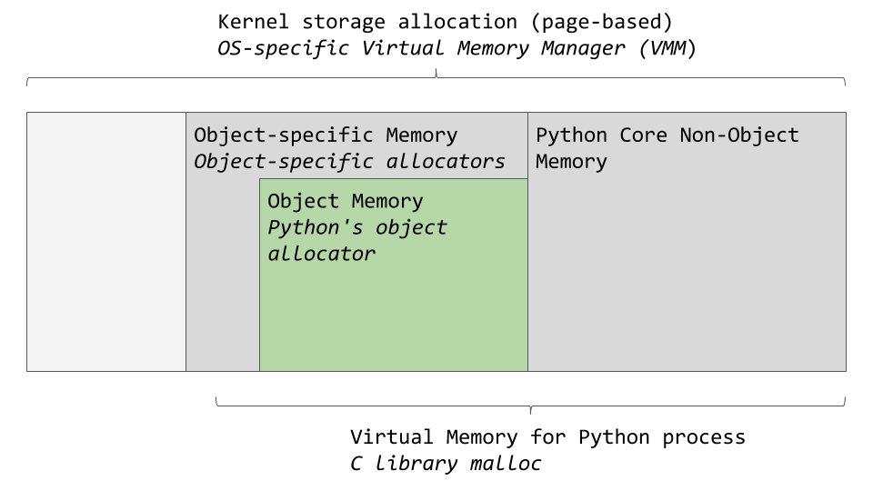
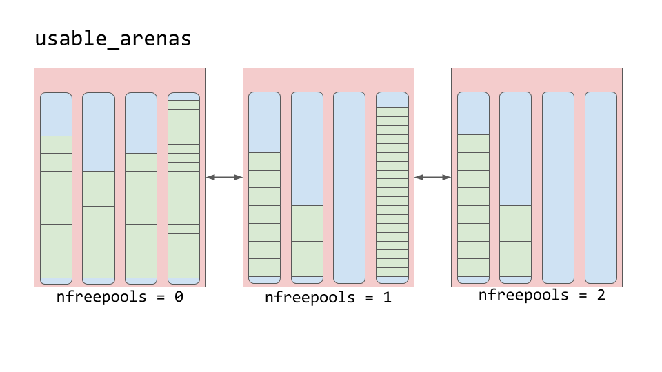

## [Memory Management in Python](https://realpython.com/python-memory-management/)

Python 在幕后决定变量存在哪里、何时删除。理解这些内部机制，能解释一部分你平时看到的行为。

### 内存像一本空白书

可以把计算机内存想成一本用来写短篇的空白书。作者不能互相覆盖，动笔前要问管理员哪几页能写。书会用很久，没人再读的故事会被清掉，给新故事腾位置。

固定长度、连续的内存块常叫作**页**，所以这个比喻很贴切。作者是需要存数据的应用程序或进程，管理员是内存管理器，清掉旧故事的人是垃圾回收器。

### 从硬件到软件

内存管理就是应用程序读写数据的过程。内存有限，管理器要找到空闲空间交给程序，这叫**分配**。数据不再需要时被删除，也就是**释放**。

数据最终落在 RAM 或硬盘这类物理设备上，但 Python 对象到达硬件之前要经过好几层。操作系统位于硬件之上，负责批准或拒绝读写请求。操作系统之上是应用程序，其中之一就是默认的 Python 实现。你的 Python 代码用的内存算法和数据结构，就在这个程序里。本文讲的是这一层。

### 默认实现是 CPython

默认实现 CPython 用 C 写成。Python 语言本身由一份英文参考手册定义，手册不能自己执行代码。还需要一个东西按手册解释代码，并在计算机上运行。CPython 同时做这两件事：把 Python 代码变成指令，再放在虚拟机上执行。

虚拟机是用软件实现的计算机，处理的是接近汇编的基本指令。Python 是解释型语言，源码会先编译成更易被机器读取的**字节码**，运行时由虚拟机解释。`.pyc` 文件和 `__pycache__` 目录里就是这些字节码。

除了 CPython 还有别的实现。IronPython 编译后跑在微软的公共语言运行时上，Jython 编译成 Java 字节码跑在 JVM 上。PyPy 是另一套实现，原文只是点到为止。本文只讨论 CPython 的内存管理。

C 本身没有面向对象。CPython 里“一切皆对象”是靠一个叫 `PyObject` 的 `struct` 实现的。C 的结构体把不同类型的数据放在一起，类似只有属性、没有方法的类。

所有 Python 对象的根基 `PyObject` 只包含两样东西：

- `ob_refcnt`：引用计数
- `ob_type`：指向另一个类型的指针

引用计数用于垃圾回收。类型指针指向另一个结构体，由它描述具体对象，例如 `dict` 或 `int`。每种对象有自己的分配器，知道如何取得存放该对象的内存；也有自己的释放函数，在对象不再需要时把内存“释放”掉。

内存是共享资源。两个进程同时写同一位置，就会出问题。

### 全局解释器锁（GIL）

两个线程同时改同一份共享资源时，会互相踩踏，结果谁都得不到想要的数据。对应到那本书：两个作者坚持同时在同一页上写，两篇故事叠在一起，整页都无法阅读。

一种办法是，线程接触共享资源时，给整个解释器加一把全局锁，同一时刻只允许一个作者写。CPython 处理内存时用 GIL 保证这样做是安全的。这个设计有利有弊，社区里争论很多。原文建议进一步阅读 [What Is the Python Global Interpreter Lock (GIL)?](https://realpython.com/python-gil/)。

### 垃圾回收

没人再读、也没人引用的旧故事，可以删掉给新内容腾地方。这对应引用计数降到 `0` 的 Python 对象。

引用计数会在几种情况下增加。赋给另一个变量：

```python
numbers = [1, 2, 3]
# 引用计数 = 1
more_numbers = numbers
# 引用计数 = 2
```

作为参数传递也会增加，例如 `total = sum(numbers)`。放进列表同样会增加，例如 `matrix = [numbers, numbers, numbers]`。

可以用 `sys.getrefcount(numbers)` 查看当前引用计数。把对象传进 `getrefcount()` 本身会使计数加 1。

计数大于 0，对象就还要留在程序里。降到 0 时，会调用该对象专用的释放函数，把内存交出去给别的对象用。

### CPython 怎么管理内存

操作系统把物理内存抽象成虚拟内存，再由系统自己的虚拟内存管理器划出一块给 Python 进程。这块内存里，一部分给解释器内部和非对象使用，另一部分专门存对象，例如 `int`、`dict`。原文把这个图简化了，完整逻辑在 CPython 源码里。



对象区域内的分配由**对象分配器**负责。每次新建或删除对象都会调用它。`list`、`int` 这类对象一次增减的数据通常不大，所以分配器针对小块数据做了优化，并且尽量拖到真正需要时才分配。

源码注释把它描述为：放在通用 `malloc` 之上、面向小块的快速专用分配器。`malloc` 是 C 的内存分配函数。

三层结构从大到小是 arena、pool、block。

**Arena** 是最大的一块，按页边界对齐。页边界是操作系统使用的、固定长度连续内存的边缘。Python 假定系统页大小为 256 KB。


Arena 里面是 **pool**。每个 pool 是一页虚拟内存，4 KB，相当于书里的一页。Pool 再切成更小的 **block**。

同一个 pool 里的 block 属于同一个 **size class**（大小等级）。请求多少字节，就分配对应等级的块。下表直接来自源码注释：

| 请求字节数 | 实际分配的块 | 大小等级索引 |
| --- | --- | --- |
| 1–8 | 8 | 0 |
| 9–16 | 16 | 1 |
| 17–24 | 24 | 2 |
| 25–32 | 32 | 3 |
| 33–40 | 40 | 4 |
| 41–48 | 48 | 5 |
| 49–56 | 56 | 6 |
| 57–64 | 64 | 7 |
| 65–72 | 72 | 8 |
| … | … | … |
| 497–504 | 504 | 62 |
| 505–512 | 512 | 63 |

例如请求 42 字节，数据会放进 48 字节的块。

#### Pool

每个 pool 只含一种大小等级的块，并用双向链表连到同等级的其他 pool。这样即使空间分散在多个 pool 里，也能按块大小找到空位。

`usedpools` 按大小等级记录“还有空位”的 pool。请求某种块时，先查这个表。

Pool 本身有三种状态：

- `used`：还有空块可以放数据
- `full`：块都已分配并装着数据
- `empty`：没有数据，需要时可以改成任意大小等级

`freepools` 记录所有 `empty` 的 pool。如果要 8 字节，而 `usedpools` 里没有 8 字节这一级，就从空 pool 里拿出一个，初始化成 8 字节块，再放进 `usedpools`。原本已满的 pool 若释放了一些块，会回到自己那个等级的 `usedpools`。因此 pool 可以在这三种状态之间变动，空 pool 还可以换大小等级。

#### Block

Pool 里有指向空闲块的指针。源码注释说，这个分配器在 arena、pool、block 每一层都尽量不碰一块内存，直到真的要用它。


因此块也有三种状态：

- `untouched`：还没分配过的内存
- `free`：曾经分配过，后来被 CPython 标成空闲，里面不再有有用数据
- `allocated`：正在存放有用数据

`freeblock` 指向一条空闲块的单向链表，也就是可以放数据的位置。空闲块不够时，再从 pool 里取 `untouched` 的块。块被标成空闲后，会加到 `freeblock` 链表的前端。这条链表里的块在内存上不一定连续。


#### Arena

Arena 里装着处于 `used`、`full` 或 `empty` 的 pool。Arena 自己没有这么明确的三种状态，而是放在一条叫 `usable_arenas` 的双向链表里，按空闲 pool 的数量排序。空闲 pool 越少，越靠近链表前面。



新数据会放进最满的那个 arena。看起来反直觉，原因是“释放”常常只是加引号的释放。块被标成空闲时，内存并不交还操作系统，Python 进程继续占着，留给以后的新数据。真正交还操作系统的单位只有 arena。

所以要让已经比较空的 arena 继续被腾空，整块内存才能真正归还，从而降低 Python 进程的总内存占用。最满的 arena 优先接收新数据，就是为了避免把快空的 arena 再次填满。

### 小结

内存管理是和计算机打交道时绕不开的部分，Python 几乎全部在幕后完成。本文说明了三件事：内存管理是什么、为什么重要；默认实现 CPython 用 C 写成；CPython 里的数据结构如何配合，为你的对象分配、留用和回收内存。

这些抽象让你在更高的层次上写代码，而不必自己追踪每一个字节存在哪里。